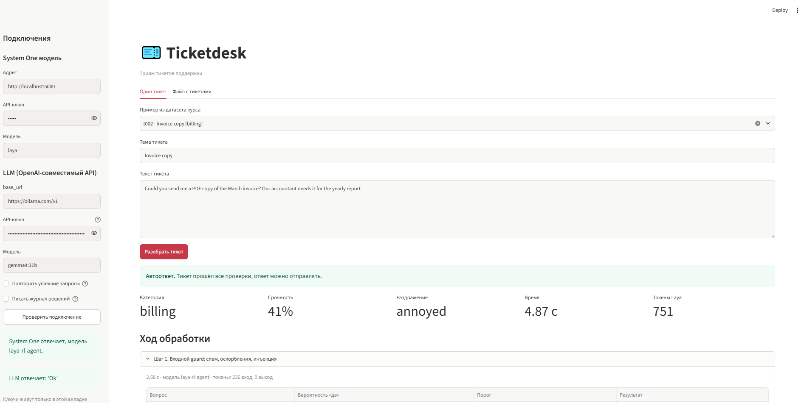
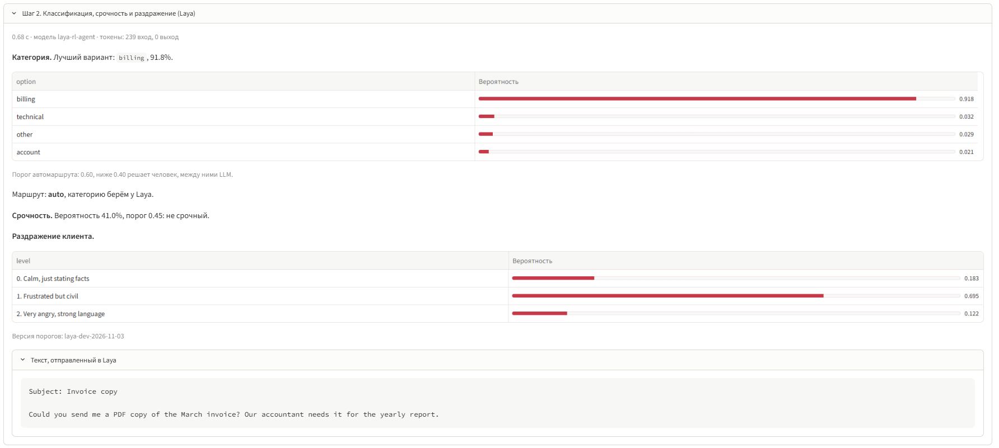
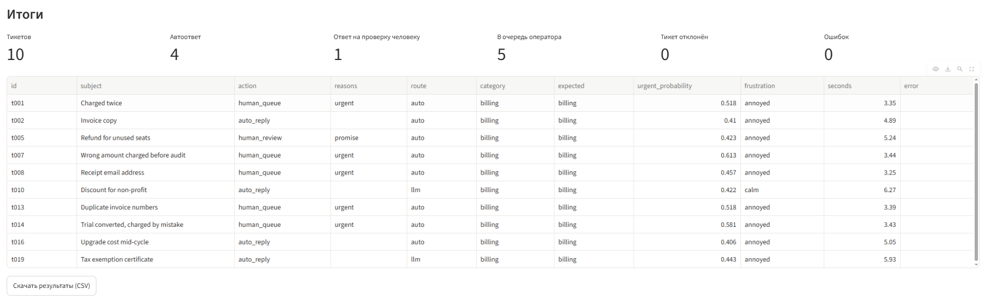

# System One Models: Jev, Kev, Laya


## Main topics

- System One Models
- Question Types: Choice, Score, Noul
- Jev, Laya, Kev, Tev1
- Calibration, Thresholds
- System Design Patterns and Production Techniques

## Getting started

```bash
uv sync
```

```bash
LAYA_PORT=5000 uv run laya-serve
```

```powershell
$env:LAYA_PORT = "5000"; uv run laya-serve
```

```bash
uv run python -m src.modules.m1_system_one.first_request
```

## Detail Program

| Module | Topic | Examples |
|---|---|---|
| **1. System One** | Parsing LLM answers | [Parsing llm answers](src/modules/m1_system_one/parse_llm_reply.py) |
|  | First Query | [Choice and Score](src/modules/m1_system_one/first_request.py), [Laya in process](src/modules/m1_system_one/laya_in_process.py) |
|  | Question Types | [Noul, Choice, Score](src/modules/m1_system_one/noul_choice_score.py), [Parallel vs sequential](src/modules/m1_system_one/parallel_vs_sequential.py) |
|  | Ticket Triage | [Example](src/modules/m1_system_one/ticket_triage.py), [Client](src/ticketdesk/client.py), [Questions](src/ticketdesk/questions.py), [Triage Function](src/ticketdesk/triage.py) |
| **2. Local Models** | Runtimes | [Running](src/modules/m2_local_models/run_tickets.py), [Comparing](src/modules/m2_local_models/compare_runs.py) |
| **3. Calibration** | Held-out and calibration | [Dataset](src/ticketdesk/data/tickets.jsonl), [Dataset loader](src/ticketdesk/dataset.py), [Collect run](src/modules/m3_calibration/collect.py), [Runs I/O](src/modules/m3_calibration/runs_io.py), [Calibration](src/ticketdesk/calibration.py), [Reliability](src/modules/m3_calibration/reliability.py), [Weather](src/modules/m3_calibration/weather.py), [Sample size](src/modules/m3_calibration/sample_size.py) |
|  | Thresholds | [Choose thresholds](src/modules/m3_calibration/choose_thresholds.py), [Service thresholds](src/ticketdesk/thresholds.py) |
|  | Weaknesses | [Order, opinion, dice](src/modules/m3_calibration/weaknesses.py) |
|  | LLM interface | [LLM interface](src/ticketdesk/llm.py) |
| **4. System Design Patterns** | Routing | [Routing](src/modules/m4_patterns/routing.py) |
|  | Guards | [Guards](src/ticketdesk/guards.py), [Demo](src/modules/m4_patterns/guards_demo.py), [False alarms](src/modules/m4_patterns/guard_false_alarms.py) |
|  | RAG and reranking | [Help center](src/modules/m4_patterns/help_center.py), [Relevance](src/modules/m4_patterns/rag_relevance.py), [Rerank](src/modules/m4_patterns/rerank.py) |
|  | Map-reduce | [Map-reduce](src/modules/m4_patterns/map_reduce.py) |
|  | Cascade, pipeline | [Cascade](src/ticketdesk/cascade.py), [Cascade demo](src/modules/m4_patterns/cascade_demo.py), [Pipeline](src/ticketdesk/pipeline.py), [Pipeline demo](src/modules/m4_patterns/pipeline_demo.py) |
| **5. Production Techniques** | Typed triage | [Typed](src/ticketdesk/typed.py), [Example](src/modules/m5_production/typed_triage.py) |
|  | Retries, fallback | [Resilient](src/ticketdesk/resilient.py), [Failures](src/modules/m5_production/failures_demo.py), [Overload](src/modules/m5_production/overload_demo.py) |
|  | Observability | [Decision log](src/ticketdesk/decision_log.py), [Write log](src/modules/m5_production/log_decisions.py), [Recompute](src/modules/m5_production/recompute_from_log.py) |
|  | Cost | [Cost](src/ticketdesk/cost.py), [Cost per success](src/modules/m5_production/cost_per_success.py) |

## Application








```bash
uv run python -m streamlit run src/ticketdesk/app/app.py
```


## Scripts

### Linters

```bash
uv run ruff format src && uv run ruff check --fix src && uv run mypy src
```
